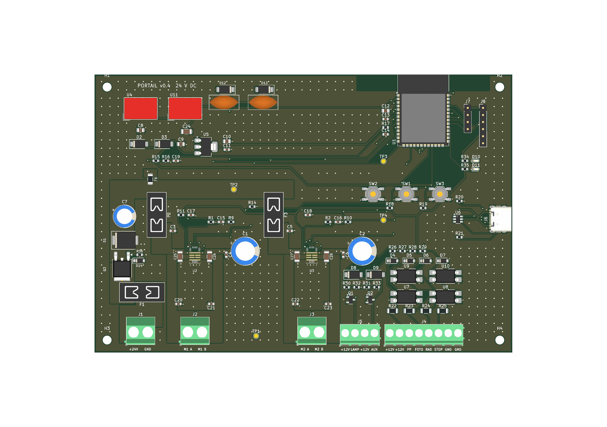

# Carte de commande pour portail à deux moteurs 24 V, avec HomeKit

Carte électronique et firmware pour piloter un portail motorisé à **deux vantaux et deux moteurs 24 V à courant
continu**, sans capteur de fin de course. Elle remplace une carte de commande du commerce tombée en panne et ajoute
Apple HomeKit, une page web de réglage et un journal des événements.

Elle a été conçue pour un portail coulissant autoportant Portaleco CT08APO-02, à deux vantaux et ouverture centrale, équipé de deux moteurs Nidec 404.854
(24 V DC), où elle remplace une carte Prastel UNIK2E.



> **Avertissement.** Un portail motorisé peut blesser gravement. Ce projet est un travail personnel, publié tel quel,
> sans aucune garantie. Il n'a fait l'objet d'aucune certification et **ne remplace pas les sécurités exigées pour un
> portail motorisé** (photocellules, limitation d'effort vérifiée à l'instrument, conformité aux normes en vigueur,
> dont l'EN 12453 en Europe). Si vous le reproduisez, vous le faites sous votre seule responsabilité.

## État du projet

- Carte **v0.4** fabriquée et assemblée, en service sur un portail coulissant Portaleco depuis novembre 2026.
- Essayé sur ce portail : mouvements complets, apprentissage des courses, détection d'obstacle par le courant
  (fermeture), photocellule (réouverture quand le faisceau est coupé à la fermeture), feu clignotant, arrêt
  progressif, HomeKit, page web, journal, mise à jour par le Wi-Fi.
- Pas encore essayé sur ce portail : entrée STOP, entrée radio,
  détection d'obstacle à l'ouverture avec un obstacle réel.
- Limite connue : par temps froid (quelques degrés), le courant des moteurs monte et s'approche des seuils appris
  par temps doux ; une fausse détection d'obstacle s'est produite une fois à l'ouverture. Les seuils sont à revoir
  selon la saison.
- Un seul portail, un seul modèle de moteur : les réglages par défaut sont des points de départ.

## La carte

| | |
| --- | --- |
| Alimentation | 24 V DC régulé (bornier J1), fusible général 15 A, protection contre l'inversion, écrêteur de surtension |
| Moteurs | 2 × pont en H TI DRV8245S réglé par SPI (borniers J2, J3), fusible 10 A par moteur, mesure du courant |
| Microcontrôleur | ESP32-S3-WROOM-1-N8, USB-C |
| Entrées (J4) | pas à pas, photocellule, radio, STOP : contacts secs, isolés par optocoupleurs, alimentés en 12 V |
| Sorties (J5) | feu clignotant et sortie auxiliaire, 12 V, commutées côté masse |
| Dimensions | 150 × 100 mm, deux couches |

- Schéma : [`schema.pdf`](schema.pdf). `schema-lisible.html` en donne une version simplifiée, par fonction
  (alimentation, commande d'un moteur, une entrée, une sortie), pour qui ne lit pas un schéma électronique.
- Projet KiCad : `kicad/`. Fichiers de fabrication : `fabrication/` et `portail-gerber.zip`.
- Nomenclature : `nomenclature.csv` ; variantes pour l'assemblage dans `fabrication/`.

**Câblage des entrées : attention au sens.** Chaque contact se branche entre `+12V_ACC` et son entrée (`PP`, `FOTO`,
`RADIO`, `STOP`). Beaucoup de cartes du commerce font l'inverse, avec des contacts qui se ferment vers un commun relié
à la masse. Un accessoire câblé pour une telle carte, par exemple un récepteur de photocellule dont le commun du
contact est ponté sur le moins de son alimentation, doit être recâblé : commun du contact sur le +12 V.
Les charges des sorties se branchent entre `+12V_OUT` et `LAMP_N` ou `AUX_N` (environ 1 A au total).

Le schéma et le circuit imprimé ne sont pas dessinés à la main : ils sont **générés par les scripts Python** de `gen/`
(`build.py` décrit le circuit, `pcb_all.py` place, route avec Freerouting et lance le contrôle des règles).

## Le firmware

Dans `firmware/portail/`, pour Arduino-ESP32 avec la bibliothèque [HomeSpan](https://github.com/HomeSpan/HomeSpan).
La notice complète est dans [`firmware/portail/LISEZMOI.md`](firmware/portail/LISEZMOI.md).

- Position estimée par le temps de fonctionnement, recalée à chaque butée.
- Butée et obstacle détectés par le courant des moteurs ; à la fermeture, un obstacle provoque la réouverture.
- Apprentissage automatique des courses et des seuils de blocage.
- Démarrage, ralentissement avant les butées et arrêt commandé progressifs.
- HomeKit : accessoire « porte de garage », plus deux capteurs d'alerte (défaut, portail resté ouvert).
- Page web sur le port 8080 : état, mesures, commandes, réglages, journal, sauvegarde et restauration des réglages.

```bash
cd firmware/portail
arduino-cli compile -b esp32:esp32:esp32s3:CDCOnBoot=cdc,FlashSize=8M,PartitionScheme=default_8MB .
arduino-cli upload  -b esp32:esp32:esp32s3:CDCOnBoot=cdc,FlashSize=8M,PartitionScheme=default_8MB -p <port> .
```

Versions utilisées : cœur `esp32:esp32` 3.3.12, HomeSpan 2.1.8.

### Sécurité réseau : à lire avant la mise en service

- La page web **n'a pas de mot de passe** : tout appareil du réseau local peut commander le portail. Ne l'exposez
  jamais sur Internet.
- La mise à jour par le Wi-Fi utilise le mot de passe par défaut de HomeSpan tant que vous ne l'avez pas changé
  (commande `O` de la console série). Changez-le, ainsi que le code d'appairage HomeKit (commande `S`).

## Régénérer la carte

Prérequis utilisés : KiCad 7 (`kicad-cli` et module Python `pcbnew`), Java 21, `xvfb-run`, Python 3 avec `cairosvg`
et `Pillow`, sous Linux. Les chemins des bibliothèques KiCad sont en dur dans `gen/kisch.py` et `gen/pcb_build.py`.
Freerouting 1.9.0 n'est pas inclus : téléchargez `freerouting.jar` depuis
[le dépôt de Freerouting](https://github.com/freerouting/freerouting) et placez-le dans `tools/`.

```bash
python3 gen/build.py        # schéma et nomenclature
python3 gen/check.py        # doit afficher OK
python3 gen/pcb_all.py      # placement, routage, contrôle des règles (plusieurs minutes)
```

## Licences

- **Matériel** (schéma, circuit imprimé, fichiers de fabrication, nomenclature, images) :
  [CERN-OHL-S v2](LICENSES/CERN-OHL-S-2.0.txt), partage à l'identique.
- **Logiciel** (firmware et scripts de `gen/`) : [GPL version 3 ou ultérieure](LICENSES/GPL-3.0-or-later.txt).

Détail et éléments tiers dans [`LICENSE.md`](LICENSE.md).

Ce projet est indépendant : il n'est ni affilié à Portaleco, Prastel, Nidec ou Apple, ni approuvé par eux. Les marques
citées appartiennent à leurs propriétaires et ne sont mentionnées que pour décrire le matériel utilisé.
